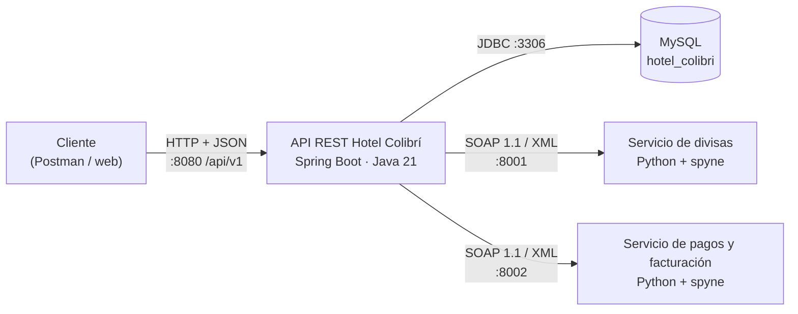
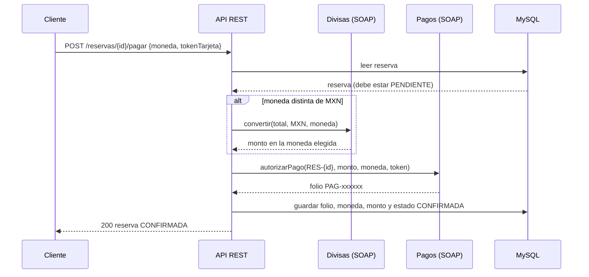

# Hotel Colibrí – Documento de arquitectura y diseño (BORRADOR · Avance 1)

> Estado: borrador para retroalimentación. Las secciones marcadas con **(pendiente)** se completan en los siguientes avances.

## 1. Descripción del sistema y diagrama de arquitectura

El Hotel Colibrí ofrece sus habitaciones en línea. La plataforma nueva es una **API REST** (fachada) que guarda los datos del hotel en MySQL y, cuando lo necesita, consume dos **servicios SOAP heredados** a partir de sus WSDL: divisas y pagos/facturación. Cada servicio corre en su propio proceso y puerto. El cliente (Postman o una web) solo habla con la API REST.

| Componente | Tecnología | Puerto | Protocolo |
|---|---|---|---|
| API REST del hotel | Java 21, Spring Boot | 8080 | HTTP / JSON (JSON-LD con schema.org) |
| Base de datos | MySQL | 3306 | JDBC |
| Servicio de divisas | Python, spyne | 8001 | SOAP 1.1 |
| Servicio de pagos y facturación | Python, spyne | 8002 | SOAP 1.1 |

## 2. Inventario de servicios

| Servicio | Tipo | Responsabilidad | Operaciones / recursos | Lo consume | Contrato |
|---|---|---|---|---|---|
| Divisas | SOAP | Convertir importes entre MXN y otras monedas con tasas fijas | `listarMonedas`, `obtenerTipoCambio`, `convertir` | API REST | `http://localhost:8001/?wsdl` · copia en `docs/wsdl/divisas.wsdl` |
| Pagos y facturación | SOAP | Autorizar y reembolsar pagos con token de prueba; emitir facturas | `autorizarPago`, `consultarPago`, `reembolsarPago`, `emitirFactura` | API REST | `http://localhost:8002/?wsdl` **(pendiente)** |
| API del hotel | REST | Gestionar habitaciones, huéspedes y reservas; componer los servicios SOAP | Ver sección 3.2 | Clientes (Postman, web, móvil) | OpenAPI (springdoc) **(pendiente)** |

**Granularidad:** divisas y pagos son servicios separados porque cambian por razones distintas (tasas de cambio vs. pasarela de pago) y porque el de divisas se puede reutilizar sin cobrar nada (una simple cotización). La API es la única que conoce ambos.

## 3. Contratos

### 3.1 Servicio SOAP de divisas (implementado)

Espacio de nombres `http://hotelcolibri.mx/divisas` · servicio `Divisas` · clase `DivisasService` · archivo `soap/divisas_service.py`.

| Operación | Entradas | Salida | Faults |
|---|---|---|---|
| `listarMonedas` | – | `Array(Unicode)` | – |
| `obtenerTipoCambio` | `origen`, `destino` (xs:string) | xs:float, 6 decimales (tasa del destino ÷ tasa del origen) | `Server.MonedaNoSoportada` |
| `convertir` | `monto` (xs:float), `origen`, `destino` | xs:float, 2 decimales | `Server.MonedaNoSoportada`, `Server.MontoInvalido` |

Tasas fijas (MXN por unidad): MXN 1.00 · USD 18.00 · EUR 21.00 · CAD 13.00.
Regla: `monto × tasa(origen) ÷ tasa(destino)`, redondeo a 2 decimales. Tipo de cambio: `obtenerTipoCambio(MXN, USD)` = 18.000000. Ejemplo: 5,400 MXN → 300.00 USD · 257.14 EUR · 415.38 CAD.
Decisiones de diseño: los montos son `float` por simplicidad (Python y Java lo manejan directo) y los Faults llevan el prefijo `Server.` porque los lanza el servidor al rechazar la petición.
Todos los parámetros de entrada son obligatorios en el WSDL (`minOccurs=1`) y el servicio valida con `Soap11(validator="lxml")`.

### 3.2 Servicio SOAP de pagos y facturación **(pendiente)**

Ver sección 5.2 del enunciado; se documenta cuando se implemente.

### 3.3 API REST: tabla de recursos (propuesta)

Prefijo común: `/api/v1`. Cada acción del ciclo de vida tiene su propia URI con el nombre de la acción, para que se entienda qué hace.

| # | Método | URI | Cuerpo | Respuesta | Códigos |
|---|---|---|---|---|---|
| 1 | GET | `/habitaciones` | – | Lista de habitaciones | 200 |
| 1 | POST | `/habitaciones` | número, tipo, capacidad, precioNoche | Habitación creada + `Location` | 201, 400, 409 |
| 1 | GET | `/habitaciones/{id}` | – | Habitación | 200, 404 |
| 1 | PUT | `/habitaciones/{id}` | datos de la habitación | Habitación actualizada | 200, 400, 404 |
| 1 | DELETE | `/habitaciones/{id}` | – | Desactiva la habitación (no la borra) | 204, 404 |
| 2 | GET | `/habitaciones?entrada=&salida=&huespedes=` | – | Habitaciones disponibles en el rango | 200, 400 |
| 3 | GET | `/huespedes`, `/huespedes/{id}` | – | Huéspedes | 200, 404 |
| 3 | POST | `/huespedes` | nombre, correo, teléfono | Huésped + `Location` | 201, 400, 409 |
| 3 | PUT | `/huespedes/{id}` | datos del huésped | Huésped actualizado | 200, 400, 404 |
| 4 | POST | `/reservas` | huespedId, habitacionId, entrada, salida, numHuespedes | Reserva PENDIENTE + `Location` | 201, 400, 404, 409, 422 |
| 4 | GET | `/reservas/{id}` | – | Reserva | 200, 404 |
| 5 | GET | `/reservas?estado=&huespedId=` | – | Lista filtrada | 200 |
| 6 | GET | `/api/v1/divisas` *(fija)* | – | Monedas disponibles | 200, 503 |
| 7 | GET | `/api/v1/reservas/{id}/cotizacion?moneda=USD` *(fija)* | – | Cotización | 200, 400, 404, 503 |
| 8 | POST | `/reservas/{id}/pagar` | moneda, tokenTarjeta | Reserva CONFIRMADA + folio | 200, 404, 409, 422, 400, 502, 503 |
| 9 | POST | `/reservas/{id}/facturar` | rfc, razonSocial | Folio de factura | 200/201, 400, 404, 409, 503 |
| 10 | POST | `/reservas/{id}/cancelar` | – | Reserva CANCELADA | 200, 404, 409, 503 |
| 10 | POST | `/reservas/{id}/registrar-llegada` | – | Reserva EN_CURSO | 200, 404, 409 |
| 10 | POST | `/reservas/{id}/registrar-salida` | – | Reserva FINALIZADA | 200, 404, 409 |

El cliente **nunca** envía precios: el total (`noches × precio por noche`) lo calcula el servidor.

Traducción de errores (ProblemDetail, sin trazas): datos inválidos 400 · inexistente 404 · traslape o transición inválida 409 · capacidad excedida o habitación inactiva 422 · `MonedaNoSoportada`/`RfcInvalido` 400 · `PagoRechazado`/`TokenInvalido` 422 · `PagoDuplicado`/`FacturaDuplicada` 409 · otro Fault 502 · servicio SOAP caído 503.

## 4. Composición: pagar una reserva **(borrador)**

| Paso que falla | Efecto | Respuesta |
|---|---|---|
| Reserva no PENDIENTE | No se llama a ningún servicio | 409 |
| Divisas: moneda no soportada | La reserva sigue PENDIENTE | 400 |
| Divisas apagado | La reserva sigue PENDIENTE | 503 |
| Pagos: pago rechazado / token inválido | La reserva sigue PENDIENTE | 422 |
| Pagos: pago duplicado | La reserva sigue PENDIENTE | 409 |
| Pagos apagado | La reserva sigue PENDIENTE | 503 |
| Cobro aprobado pero falla la BD al guardar | Compensación propuesta: la API llama a `reembolsarPago` con el folio recién obtenido para no cobrar sin reserva confirmada; si el reembolso también falla se registra el folio en la bitácora para conciliarlo a mano | 502 (o 500 si el reembolso sí se hizo) |

## 5. Principios de SOA **(borrador: evidencia concreta por completar)**

| Principio | Evidencia en el proyecto |
|---|---|
| Contrato estandarizado | WSDL de divisas con operaciones, tipos y Faults fijados por el enunciado (`docs/wsdl/divisas.wsdl`). |
| Bajo acoplamiento | La API solo conoce el WSDL, no el código Python; la URL del servicio irá en `application.properties`. |
| Abstracción | El cliente de la API no sabe qué es un WSDL ni en qué puerto corre cada servicio. |
| Autonomía | Cada servicio SOAP corre en su propio proceso y puerto (8001, 8002). |
| Reutilización | `convertir` sirve para cotizar y para pagar. |
| Ausencia de estado | El servicio de divisas no guarda nada entre llamadas; la API REST no usa sesión. |
| Descubribilidad | `?wsdl` publicado en cada servicio y OpenAPI en la API **(pendiente)**. |
| Composición | Pagar compone Divisas + Pagos + BD (sección 4). |

## 6. Glosario de datos

| Concepto del hotel | Tipo de schema.org | Propiedades |
|---|---|---|
| Reserva | `LodgingReservation` | `reservationId`, `reservationStatus`, `checkinTime`, `checkoutTime`, `underName`, `reservationFor`, `totalPrice`, `priceCurrency`, `numAdults` + propia `estadoHotel` |
| Habitación | `HotelRoom` | `identifier`, `name`, `occupancy` (`QuantitativeValue` con `maxValue`), `offers` (`Offer` con `price` y `priceCurrency`) |
| Huésped | `Person` | `identifier`, `name`, `email`, `telephone` |
| Cotización | `PriceSpecification` | `price`, `priceCurrency` |
| Estado de la reserva | `ReservationStatusType` | ver tabla de abajo |

| `estadoHotel` | `reservationStatus` (schema.org) |
|---|---|
| PENDIENTE | `ReservationPending` |
| CONFIRMADA | `ReservationConfirmed` |
| EN_CURSO | `ReservationConfirmed` |
| FINALIZADA | `ReservationConfirmed` |
| CANCELADA | `ReservationCancelled` |

